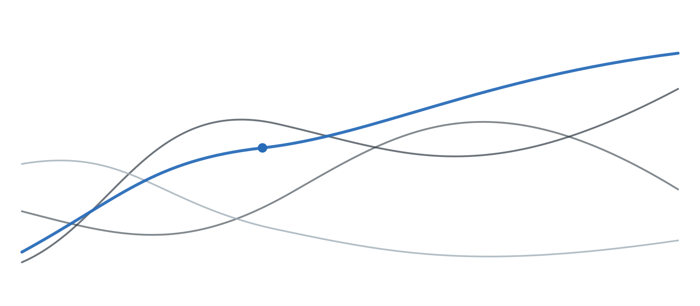
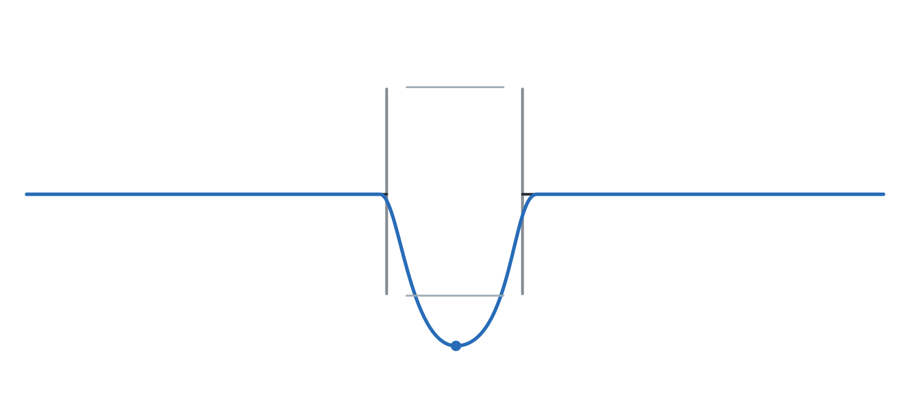
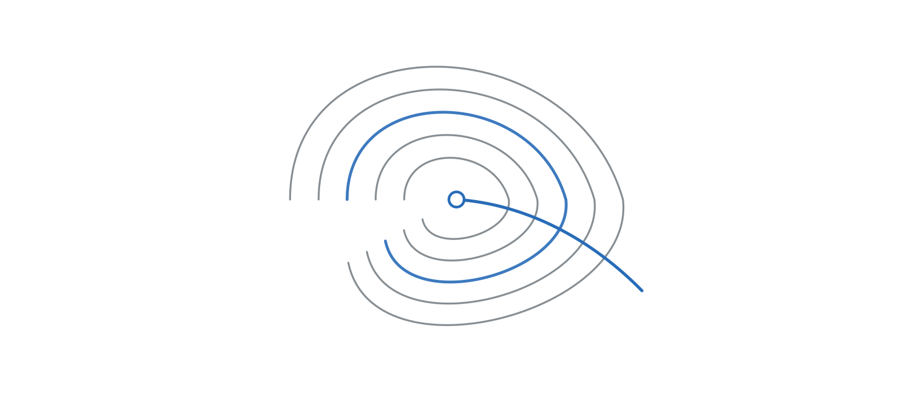
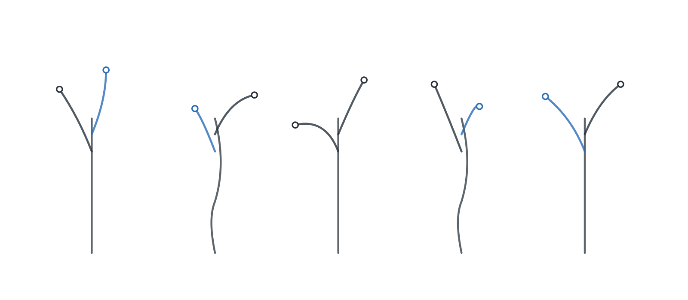
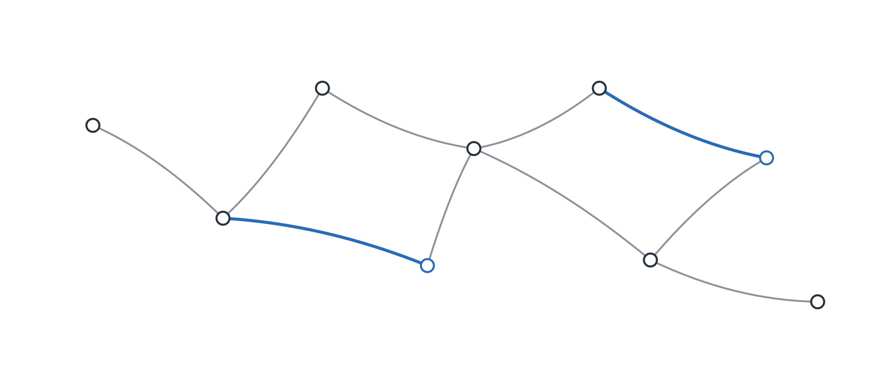
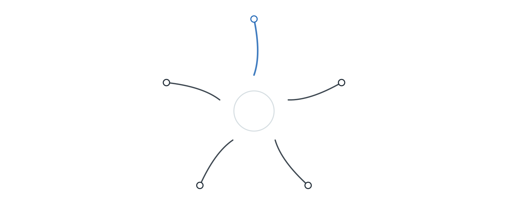

# The Five Values

*Hope · Acceptance · Reflection · Growth · Community*

*A companion to The Book of Chance*  
*By H · BOC-BKL-001 · Editorial candidate 1.0-RC1 · 22 November 2026*

## A compass, not a scorecard

There is a difference between knowing what matters to us and knowing what to do next. We may care about kindness but be unsure whether an offer of help would be welcome. We may value honesty and still struggle to find words that do not wound. We may want to change a difficult situation while recognising that much of it lies beyond our control.

A value does not eliminate those difficulties. It gives us a question worth carrying into them.

Confluent Humanism gathers its practical outlook around five values: **Hope, Acceptance, Reflection, Growth and Community**. They are not five steps toward becoming a better class of person. They cannot be earned as badges, measured by a score or used to explain why one life has been more fortunate than another. They describe ways of paying attention to a life that is already valuable.

The underlying philosophy holds, as a *philosophical conviction*, that chance belongs to the nature of reality and that the future is not wholly written in advance. Circumstances, causes, inherited advantages and disadvantages, other people and our own decisions all shape what occurs. This is not scientific proof of an open universe, and randomness alone does not establish free will. The ethical case for treating one another with dignity must stand on its own reasons.

Four sentences express the direction of this philosophy:

> We exist through chance.  
> Our actions influence the chances of others.  
> Together, we can create possibilities that none of us could create alone.  
> When chance favours us, we share what we can.

The five values help us think about how to live with those sentences. **Hope** asks what might yet be possible. **Acceptance** asks what is true now. **Reflection** asks what we have understood and what we may have overlooked. **Growth** asks how our capacities or understanding might change. **Community** asks who else is affected, included or left outside.

None should rule over the others. Hope without acceptance can become denial. Acceptance without hope can be mistaken for resignation. Reflection without mercy can become self-punishment. Growth without rest can become a demand to perform. Community without boundaries can become pressure rather than care.

This short book is an introduction, not a test of belief. Read it independently, disagree where you wish and change any suggested practice to suit your circumstances. You do not need to join the Fellowship of Chance, share your private reflections or make a donation to use it.

## 01 · Hope

*Remain open to a possible future without promising what it will contain.*

Imagine a small music room. An older woman has brought in a battered instrument after years of leaving it untouched. She is not certain that her hands will remember the notes. She may never play at the level she once did, and there are good reasons she stopped. She asks the teacher whether they can begin with a single melody.

This is an invented scene. Its importance is not that practice will certainly restore what was lost. It is that hope can take the modest form of making room for an attempt.

Hope is often confused with confidence. We tell someone to *believe everything will work out*, as though that belief makes the outcome more likely. But a person can be hopeful while naming serious dangers. A family can hope for good news while preparing for difficult news. Someone can hope for reconciliation while recognising another person's right not to return.

Hope does not require cheerfulness. It may be a feeling, a choice to prepare, or the willingness to remain beside a person when no solution is available. Sometimes hope is absent altogether. Grief, exhaustion and fear can make even imagining a future feel impossible. That absence does not make anyone less worthy of kindness.

There is also a difference between hope and expectation. To expect a result is to judge it likely. To hope for it is to care that it might occur. We may act on a hope without pretending to know the odds. If the possibility closes, our hope may change. We need not keep rehearsing an outcome that can no longer arrive.

Where Hope becomes social is particularly important. It is hard to imagine a way forward when every practical door is closed. A neighbour who shares reliable information, a teacher who makes an activity accessible or a public service that removes an arbitrary barrier can turn hope into something a person can reasonably attempt. Such actions do not control chance. They alter the circumstances in which choices are made.

**Hope asks:** *What remains possible—and what honest preparation or support could make it more reachable?*

**Try, if useful:** Name one outcome you care about but cannot guarantee. Distinguish what you can prepare from what you cannot command. If even that feels too demanding, leave the question for another time.

**A question to carry:** When has another person's practical help made a possibility visible to you?

## 02 · Acceptance

*Recognise reality without treating every part of it as acceptable.*

A town library has an entrance that many people can use and others cannot. A visitor using a mobility aid reaches the steps and discovers that the alternative entrance is locked. The steps are real; wishing them away will not open the door. But acknowledging the barrier does not mean approving it. The library has a responsibility to change the conditions of access.

This is an imagined illustration, not an account of a particular library. It shows two meanings that should not be confused. **Acceptance** can mean recognising a fact. It need not mean endorsing that fact or abandoning the work of changing it.

We often spend energy arguing inwardly with an event that has already occurred. An opportunity has closed. Someone has spoken words we cannot unsay. A loss has altered the shape of a household. We may wish the past were different, but our wish cannot revise the record. Acceptance begins with an honest encounter with what is here.

That encounter may hurt. No value asks us to be pleased by injustice, suffering or grief. Acceptance is not forgiveness on demand. It is not a request that a disabled person adapt silently to exclusion, or that an abused person remain in danger. Sometimes recognising the truth makes resistance clearer: *this happened, this is harmful, and it should not be allowed to continue*.

Our limits deserve similar honesty. We are not equally resourced or equally safe. We do not control every consequence of our decisions. We may be unable to provide the care, energy or money another person needs. It can be difficult to say, *I cannot do that*. Yet promising more than we can offer may place both people at risk.

Acceptance also has a place in relationships. We can listen to someone who disagrees with us without pretending the disagreement has disappeared. We can respect another person's refusal without reading it as a final judgement on our worth. We can admit that an explanation is incomplete without manufacturing certainty to end discomfort.

Hope and Acceptance work best together. Hope asks what may change; Acceptance asks what must be faced before change can be responsible. Neither replaces the other.

**Acceptance asks:** *What is true, what remains uncertain, and what should be challenged rather than merely endured?*

**Try, if useful:** Write or think three sentences: “What has happened is …”; “What I cannot currently control is …”; “What may still deserve a response is …”. There is no requirement to share them.

**A question to carry:** Is there something you have been asked to “accept” when what you really needed was support or a fairer condition?

## 03 · Reflection

*Look again with curiosity, evidence and compassion.*

After a meeting, someone notices that a colleague grew quiet. They replay every sentence on the journey home. Perhaps they caused offence. Perhaps the colleague was tired. Perhaps a subject discussed in the meeting was difficult for reasons nobody else knew. There is a difference between noticing silence and claiming to know its meaning.

This invented moment illustrates a useful discipline: **reflection separates observation from interpretation**. It can ask what happened, what we felt, what we assumed and what further information might change our understanding.

In *The Book of Chance*, the **Reflection of Chance** offers an optional way to review circumstances, choices and what may become possible. It can be written, spoken, drawn, held in thought or explored with someone trusted. It need not be daily. It need not be long. Its purpose is greater understanding, not a perfect record.

A useful reflection may contain four kinds of attention. First, **circumstances**: what was given or constrained, including other people's actions? Second, **choices**: what did I actually decide, and what information was available then? Third, **learning**: what do I see differently now, and which conclusions remain uncertain? Fourth, **possibility**: is there a modest action, conversation or preparation that might matter next?

A fifth element is sometimes forgotten: **appreciation**. Not every experience must teach a lesson or improve a skill. A quiet meal, a funny story or a view from a bus window may be worth remembering simply because it happened.

Reflection can also go wrong. If it becomes an endless trial in which every painful result proves a personal failure, it has lost its purpose. We cannot reconstruct the future that would have followed every alternative decision. We may need to stop writing, rest, ask for perspective or seek appropriate professional support when distress is persistent. A notebook should not be another authority demanding an explanation for every wound.

Privacy is part of the practice. No reader needs to hand over their reflections to H, the Fellowship or anyone else. A personal journal is not a membership record, a confession or a condition for receiving help.

**Reflection asks:** *What did I observe, what am I assuming, and what would it be fair to learn from this?*

**Try, if useful:** Describe a recent experience using two separate headings: “What I know happened” and “What I think it might mean.” Leave room for uncertainty.

**A question to carry:** When does looking back help you, and when does it begin to keep you from living in the present?

## 04 · Growth

*Allow understanding and capacity to change without making achievement the measure of a life.*

A volunteer has been organising neighbourhood activities for years. They know how to fill a room and keep a schedule. At a recent gathering, someone explains that the programme assumes everybody can travel, speak confidently and stay for two hours. The organiser's first response is defensive. Their next is to listen. They change how invitations work, share responsibility and become less central to a project they care about.

The story is imagined. The change it describes is not a promotion or a larger achievement. It is a willingness to revise a familiar way of doing things.

Growth takes many forms. We can acquire knowledge, practise a skill or become more confident. We can also unlearn a habit, question a long-held assumption, recognise a limit or learn to apologise. A person who changes their mind when evidence demands it may be growing intellectually even while losing an argument. Someone who rests rather than pushes into exhaustion may be growing in self-understanding.

It is tempting to turn growth into a command: do more, earn more, become more efficient, recover faster. But lives unfold within unequal circumstances. A person managing chronic pain, caring for family, living through grief or simply keeping themselves safe may have little room for visible accomplishments. None of this diminishes their worth. A useful philosophy should not disguise relentless productivity as virtue.

Growth is not always comfortable, but discomfort is not proof that growth is happening. Being overwhelmed, unsupported or exposed to avoidable harm is not an educational requirement. We should ask whether a challenge is chosen, whether resources are available, and whether someone can stop without punishment.

There is also value in becoming more able to receive care. We may learn to ask a question sooner, allow a friend to assist, accept that another person's expertise matters or revise an expectation we have carried for years. These changes are sometimes invisible from the outside.

Growth is neither a competition nor a staircase on which everyone must stand. It is the possibility of becoming differently capable, differently informed or differently attentive across a life that already matters.

**Growth asks:** *What could change in my understanding, habits or relationships—and who gets to decide whether that change is worth pursuing?*

**Try, if useful:** Consider a belief you have revised, a boundary you have learned to keep or a skill you no longer wish to pursue. What made the change meaningful to you?

**A question to carry:** What form of growth would still matter if nobody could measure or applaud it?

## 05 · Community

*Make room for shared possibility while protecting each person's dignity and freedom.*

At a local repair table, one visitor knows how to fix a loose bicycle chain. Another brings a tool. A third person has come because they cannot afford a repair and has nothing to offer in return. Someone else simply sits, watches and enjoys being among people. The table is better because knowledge and resources have been shared. It is also better if nobody is told they must earn their place.

This is an imagined gathering, not an account of an active Fellowship programme. It illustrates a difference between **community as a transaction** and **community as belonging**. A group concerned only with what each person can contribute will eventually exclude the people who most need company and care.

Community begins in relationships but does not end there. Our opportunities are shaped by people we know and people we never meet: workers, neighbours, institutions, predecessors and future generations. The point is not to turn every relationship into a useful connection. Sometimes a friendship matters precisely because nobody is calculating what might be gained.

The Fellowship of Chance hopes eventually to provide opportunities for discussion, mentorship, shared projects and practical support. Those programmes are not yet operational simply because a book describes them. A trustworthy community must build its capabilities, safeguarding and governance before promising help it cannot reliably provide.

For individuals, an **Act of Possibility** may be modest: asking whether someone would welcome an introduction, sharing accurate information, returning a borrowed tool, including someone in a conversation or supporting a cause through an accountable organisation. We should ask first when an action affects another person. A refusal is not an insult. An offer of help does not buy access to somebody's story, gratitude or future loyalty.

Community also needs structures that are fair. Kind gestures are valuable; they cannot replace accessible services, reliable institutions or decisions that listen to people affected by them. And care must have limits. Nobody should risk essential needs to prove generosity. Receiving support is a legitimate form of participation. Criticism, disagreement and the freedom to leave must remain possible.

Confluent Humanism holds concern for people alongside concern for animals, ecosystems and the conditions that support future life. We cannot foresee every consequence, but we can ask whose interests are not represented in the room.

**Community asks:** *Who is affected, who is missing, and what could we create together without making anyone's dignity conditional?*

**Try, if useful:** Notice one place where someone faces an unnecessary obstacle to participation. Before proposing a solution, ask whose account of the obstacle is missing.

**A question to carry:** Can a person decline to give, disagree or need help and still belong to the communities you value?

## When values pull in different directions

The five values are not instructions to apply in order. In a difficult situation they may point to different parts of the problem.

Imagine that a friend asks you to help organise a long community event. You care about the project, but you have been ill and have little energy. Hope suggests that the event could be worthwhile. Acceptance names your current limits. Reflection notices that you have often agreed too quickly. Growth might mean learning to say no. Community asks how your refusal can be respected while the group finds another arrangement.

The wise response may not be a compromise in which you give half the energy you do not have. It may be a clear boundary and a more accessible plan.

In another situation, a group wants to share personal stories to encourage new participants. Community may favour openness; Reflection asks what those stories reveal; Hope imagines who might benefit. Acceptance notices that some people are not safe being publicly identified. Growth may require learning how to build trust without demanding disclosure. Here, privacy is not a rival to fellowship. It is one of the conditions that make genuine fellowship possible.

These examples show why it is important not to rank the values. There is no universal formula that turns them into one correct answer. People may disagree in good faith. Evidence may be incomplete. Institutions may hold responsibilities that cannot fairly be shifted onto individuals.

When the values conflict, try five questions:

1. **What is real?** Name the facts, uncertainties and limits. (Acceptance)
2. **What might still be possible?** Avoid promising a particular result. (Hope)
3. **What have we assumed?** Seek the perspectives and evidence we lack. (Reflection)
4. **What could we change or learn?** Include the option of stopping, resting or revising a plan. (Growth)
5. **Who bears the consequences?** Ask about consent, fairness, the absent and the vulnerable. (Community)

No answer should require sacrificing a person's basic safety or dignity to prove loyalty to the values. If the stakes are high, seek appropriate expertise and accountable processes. A philosophical guide does not replace medical, legal, safeguarding or emergency judgement.

## A practice you may make your own

You can use this booklet without writing anything down. If you would like a brief practice, choose **one** value that seems useful today. Ask its question once. Notice what comes to mind. You may stop there.

If it helps, consider a week in which the values come and go according to your circumstances. One day you might notice a possibility. On another you might recognise a limit. Another day may call for an apology, a new skill, a conversation or simply rest. There is no required sequence, streak or completion mark.

The **Reflection of Chance** offers a more structured practice; the **Act of Possibility** turns attention toward a voluntary action that may widen another being's opportunities. Both are described in *The Book of Chance*, and free journals and worksheets are available in the online Library. They are tools for readers, not material the Fellowship asks to collect.

A shared discussion can be just as simple. Two people might each choose a value that troubles them, explain why, listen without interruption and decide not to settle the disagreement. A conversation that leaves room for thought can be worthwhile without producing consensus.

A final question: **Which value helps you see what matters now, and which value might challenge the way you usually see it?**

## A note on this booklet

*The Five Values* is an accessible companion to *The Book of Chance: On the Lives We Inherit and the Futures We Shape*. It draws especially on Reading VI (*Reflection and Growth*), Reading VII (*Hope*), Reading VIII (*Shared Fortune*), Reading IX (*Fellowship*) and Reading X (*The Living World*). The five value names and their shared, non-hierarchical role are also described in the draft *Fellowship of Chance Identity and Values Charter* (v1.0-RC1). The philosophical vocabulary has points of contact with older traditions of practical wisdom, acceptance, care and reflective living; this booklet does not claim to have invented them.

Every scene in this booklet is **fictional and illustrative**. No case is presented as a verified account or a testimonial. The examples are not operational promises from the developing Fellowship. Where the underlying philosophical convictions are contested, reasonable readers may disagree. H's byline represents authorship, not infallibility.

**Publication identity:** BOC-BKL-001 · First editorial candidate 1.0-RC1 · 22 November 2026 · Language en-NZ. Free to read or download without registration, payment or membership. Digital edition prepared for editorial approval; printed editions would require separate production and rights checks.
